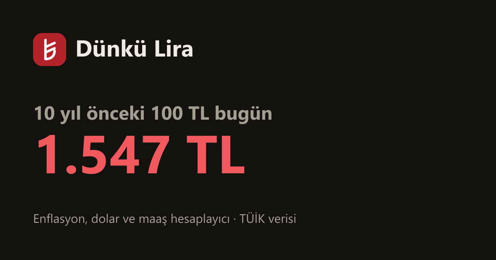

# Dünkü Lira

**O zamanın parası bugün kaç lira?** Türkiye için enflasyon, döviz ve maaş hesaplayıcı.

🔗 **https://necatimertmetin.github.io/dunku-lira/**



## Neler yapar

- **Geçmişteki para bugün kaç lira?** Bir tutar ve ay seç; TÜİK TÜFE'ye göre bugünkü karşılığını, fiyatların kaç kat arttığını, alım gücü kaybını ve yıllık ortalama enflasyonu gösterir. Tersine de çalışır: bugünkü para eskiden kaç liraydı?
- **O gün ne yapılsaydı?** Aynı para yastık altında TL, enflasyon kadar artan, dolar ya da euro olarak tutulsaydı bugün kaç lira olurdu (anlık kurla).
- **Maaşım eridi mi?** Eski maaş, tarihi ve şimdiki maaşla zammın enflasyonu karşılayıp karşılamadığını, eski alım gücü için gereken maaşı hesaplar.
- **Grafik:** Fiyatlar, dolar ve euro seçilen yıldan bu yana kaç kat arttı (logaritmik/doğrusal).
- **Yıl yıl tablo:** 2006'dan bu yana yıllık enflasyon ve dolar/TL değişimi.
- **Paylaş:** Sonuç bir bağlantıyla paylaşılır (`#t=100&ay=2016-09`).

## Veri

| Veri | Kaynak |
| --- | --- |
| TÜFE (2015=100), aylık, 2005'ten bu yana | TÜİK, [OECD SDMX API](https://sdmx.oecd.org) üzerinden |
| OECD'de henüz olmayan son aylar | TÜİK aylık açıklamaları, `data/tuik-monthly.json` |
| USD/TRY, EUR/TRY aylık ortalama ve anlık kur | Avrupa Merkez Bankası, [Frankfurter](https://frankfurter.dev) |

`scripts/fetch-data.mjs` veriyi indirip `src/data/series.json` dosyasını üretir. TÜİK'in elle girilen aylık oranları, TÜİK'in yayımladığı yılbaşından bu yana kümülatif değişimle karşılaştırılır; tutmazsa betik hata verir. Testler de 2022–2025 yıllık enflasyonunun TÜİK rakamlarıyla eşleştiğini doğrular.

GitHub Actions her ayın 6'sında veriyi yeniler, testleri çalıştırır ve siteyi yeniden yayınlar.

**Yeni ay eklemek:** TÜİK açıklamasından sonra `data/tuik-monthly.json` içine aylık değişimi (ve istersen kümülatif kontrol değerini) ekle, `npm run data` çalıştır.

## Geliştirme

```bash
npm install
npm run dev     # http://localhost:5173/dunku-lira/
npm test
npm run data    # veriyi yenile
npm run build
```

React 19 + TypeScript + Vite. Sunucu yok.

Hesaplar resmî TÜFE'ye göredir; kişisel enflasyon harcama sepetine göre farklı olabilir. Yatırım tavsiyesi değildir.

## Lisans

MIT
